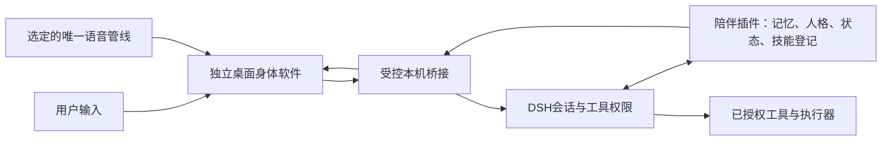

# 可执行技能学习与独立虚拟身体路线

日期：2026-11-02。用户要求：后续加入真正的技能学习，结合AIRI与dsh-plugin-live2d-stage开发专门连接陪伴插件的独立软件。本轮完成源码和本机只读接口核查、更新开发顺序；没有安装第三方程序、复制上游代码/模型、执行动作或改动1.16.0运行包。

## 核查结论及证据范围

**结论：有可复用的渲染和交互基础，架构上可行；尚未证明两项目与当前DSH版本能直接兼容运行。** 需要适配器和隔离原型，不把两个现成程序直接合并，也不称已接通身体。参考版本按以下提交固定，实施前重新检查差异。

| 项目 | 核查基线 | 已核实 | 尚未验证 |
|---|---|---|---|
| [AIRI](https://github.com/moeru-ai/airi/tree/85978164519e902c447b354933ae83b8e20bb174) | 0.14.1；85978164519e902c447b354933ae83b8e20bb174 | Electron桌面应用、Live2D及VRM渲染模块、口型驱动相关包、插件SDK和WebSocket客户端源码存在 | 本机编译、渲染和资源占用；关闭其独立聊天/记忆/模型调用后的最小接入；没有验证它原生消费本插件`/state` |
| [dsh-plugin-live2d-stage](https://github.com/B612plant/dsh-plugin-live2d-stage/tree/bc6fe3260b349098b123c2b6170e666e535cd255) | 0.5.3；bc6fe3260b349098b123c2b6170e666e535cd255 | DSH会话服务、动作/表情目录、SSE播放器、Windows x64/WebView2悬浮载体及动作工具；宿主准入检查 | 当前DSH兼容运行；跨进程动作准入；动画完成/取消回执；本机实际悬浮渲染 |
| 当前陪伴插件 | 1.16.0 | `love_learn`是name/note/source/date/times笔记；已有状态快照和动作建议代码 | 没有可执行技能清单、练习/验证/晋级、独立身体软件和完整语音同步 |

源码依据：

- AIRI：[桌面依赖](https://github.com/moeru-ai/airi/blob/85978164519e902c447b354933ae83b8e20bb174/apps/stage-tamagotchi/package.json)、[Live2D导出](https://github.com/moeru-ai/airi/blob/85978164519e902c447b354933ae83b8e20bb174/packages/stage-ui-live2d/src/index.ts)、[插件SDK契约](https://github.com/moeru-ai/airi/blob/85978164519e902c447b354933ae83b8e20bb174/packages/plugin-sdk/README.md)、[传输客户端](https://github.com/moeru-ai/airi/blob/85978164519e902c447b354933ae83b8e20bb174/packages/server-sdk/src/client.ts)。SDK契约和传输代码存在，不等于本项目所需端到端授权/事件链已可用。
- 舞台：[HTTP准入/SSE/工具](https://github.com/B612plant/dsh-plugin-live2d-stage/blob/bc6fe3260b349098b123c2b6170e666e535cd255/src/index.mjs)、[原生载体准入](https://github.com/B612plant/dsh-plugin-live2d-stage/blob/bc6fe3260b349098b123c2b6170e666e535cd255/src/floating.mjs)、[会话控制](https://github.com/B612plant/dsh-plugin-live2d-stage/blob/bc6fe3260b349098b123c2b6170e666e535cd255/src/chat.mjs)。`live2d_present`立即返回提交结果，不能把它当作动画实际播放完成。
- 本库：`plugin/runtime/learning.js`、`plugin/tools/learn.js`、`plugin/airi-state.js`、`plugin/live2d.js`和`plugin/http/companion-routes.js`。

本机只读核查：`/love-companion/api/state`返回200；`/love-companion/api/avatar`返回200但available=false；`/live2d-stage/state`返回404。只保存路径、状态码及能力结论，不保存正式对话、身份或状态正文。[结构化证据](reports/evidence/2026-11-02-learning-body-research.json)。这些结果不替代程序启动、动作、语音和技能执行验收。

## 一个会话和记忆权威，独立身体进程

- DSH继续持有模型会话、原生工具和审批；陪伴插件保存记忆、人格、情绪依据及技能版本。新软件默认只连接配置的陪伴工作区，不浏览全机所有聊天。
- 身体是独立窗口/进程、可单独启动及显示离线待机；对话、记忆和工具执行仍需要DSH运行。“独立软件”本轮不等于另造或内嵌第二套DSH/大模型宿主。
- 推荐先隔离验证AIRI的最小Live2D渲染和Electron载体，停用其平行的聊天、记忆和自动模型调用，避免出现两套人格与两份记忆。VRM随后作为可替换渲染后端。不要默认携带整个AIRI单仓库和所有原生依赖。
- 舞台项目优先借鉴并适配动作目录、动作/表情组合、悬浮交互和宿主会话衔接；以可替换适配器接入。不要让AIRI与原舞台同时播放同一角色或同时收音/朗读。优先选择一个实际渲染器，另一个只承担协议兼容或作为备选实现。
- 桥接协议需要版本、匿名范围句柄、事件ID/序号、时间/过期时间、动作能力、取消与回执。默认只提供身体所需状态；完整记忆、群聊、昵称、路径和凭据不随状态广播。
- 优先验证仅当前用户可访问的本机IPC；若使用HTTP/WebSocket，须验证宿主现有准入与跨来源隔离。保留“不恢复通用API token”的既定决定，不使用无鉴权公开控制端口，不绕过舞台`connection.admit`或复制其原生载体临时准入凭据。
- 当前`buildAiriState`只是本库自定义快照；`presence.speaking`由上次入站时间估计，不是真实TTS播放时钟。新身体必须用真实语音开始/分块/停止/取消事件驱动口型，不能靠这个布尔值证明正在说话。

## “学会技能”的最小闭环

这里的学习定义为：把教学/经验变为可复用、可执行、经过验证并能跨重启保留的方法。不是更新基础大模型权重；写入一段笔记、增加times或口头说“学会了”均不算通过。

流程：**用户教学或任务失败 → 候选方法 → 绑定真实工具/版本与权限 → 隔离练习 → 独立验收 → 晋级 → 执行与记录 → 更正、降级或回滚**。

技能清单至少包含：

| 字段组 | 内容 |
|---|---|
| 身份与范围 | id、version、状态、workspace/scope、来源与适用条件、依赖版本 |
| 输入输出 | inputSchema、outputSchema；严格字段、必需项、类型/长度/枚举与失败结果 |
| 工具绑定 | 已存在的toolId及参数schema、步骤与有界条件分支；不能凭空生成工具或任意eval脚本 |
| 权限与资源 | 所需能力、批准范围及有效期、允许目录/域/对象、调用/费用/超时/并发上限 |
| 练习与验收 | 固定训练用例、未用于生成的保留用例、实际工具结果和产物、验证器版本、人工复核 |
| 执行与恢复 | 前置/后置条件、幂等键、取消策略、补偿动作、上一个可用版本、失败原因与审计记录 |

保留现有学习笔记和核心技能记录；新增可执行技能登记与它们分开。旧times或一段教学文字只可作为候选来源，不能在升级时自动标成verified。方法内容由模型根据真实教学/经验提出，插件校验格式、范围、依赖和产物，不用固定模板冒充自主学习。

状态区分：candidate → practicing → verified → enabled；另有disabled、deprecated、failed。模型可提出候选与改进，不能自授权限、把自己的评价当成独立验证器或自行晋级成可对外执行。

回滚优先指向技能版本及可补偿的本地测试产物；已经发出的外部消息、上传或付款不能承诺自动撤销，因此不进入首批练习。

首批只选隔离目录内的低风险方法，例如从测试资料生成可核对的结构笔记；渲染器接通后增加“选取目录中存在的表情并恢复待机”。上网找图、浏览器/电脑操作、头像发布属于后续能力，不能因新增学习按钮就默认可用。

初始验收目标（尚未实现）：在明确适用范围内，20个不同材料/参数用例至少18个得到验证过的正确产物，其中至少5个保留用例；跨3次重启可复用同版本技能；越范围、未授权和错误工具版本全部拒绝；取消/失败不谎报完成。可确定验证的产物用程序检查，语义判断另做人工抽查，不重复付费让模型自评20次。这些只是工程门槛，不是一般智能或统计成熟度证明。

练习默认关闭，显式开启后设置单独可见的预算并进入统一调度；涉及模型的生成、修正和评审均记账。不得借前台工具或新进程偷偷绕过现有后台6次限额，也不把现有后台限额冒充所有学习调用的总预算。

## 各层职责与能力边界

| 能力 | 宿主/其他服务负责 | 陪伴插件负责 | 身体软件负责 |
|---|---|---|---|
| 搜图片/网页 | 实际搜索/下载工具、网络权限、可引用来源 | 技能方法、范围、结果与失败证据 | 展示候选；不自行上传私人材料 |
| 看图 | 可用视觉模型或图像工具；待能力探针确认 | 保留来源、识别不确定性和经验 | 用户选择输入与显示结果 |
| 浏览器/电脑 | 宿主执行、审批、沙箱/目录限制、取消；待实测接口 | 调度已授权步骤、验证与审计 | 显示进度和审批入口；不持有无限制控制权 |
| 本地身体表情 | 已授权动作能力、真实目录与播放器 | 选择/学习何时使用，记录验证结果 | 实际播放、过渡、抢占/取消和播放状态 |
| 本地模型/头像更换 | 用户本地素材选择、导入与资源权限 | 记录偏好与可回滚方案 | 资源加载、预览、恢复旧模型 |
| 外部账号头像/发消息 | 服务明确接口和用户对该对象的授权 | 不能把本地换装权限外推成发布权限 | 仅预览/请求宿主执行，不默认对外发布 |
| 语音 | 选定一套STT/TTS管线（可沿用Agent Voice，接入待验收） | 状态和输出事件关联 | 按实际音频驱动口型、字幕和打断 |

网页、图片文字、附件和命令输出仍是资料，不能成为授权。技能不得默认开放任意shell代码执行、安装未知程序、读取凭据、全盘扫描、关闭安全设置、自动支付/上传/对外发布。确有任务需要某能力时，单独设计宿主授权与隔离执行，不由学习器自行开通。

## 更新后的执行顺序与门槛

| 顺序 | 工作 | 通过条件 |
|---|---|---|
| 0 当前继续 | 1.16.0自然日用观察、修明确故障 | 保留原有30次有意义互动/3类话题/10次新会话回忆/5次更正目标；样本不足延长，严重越界/损坏立即停止扩展 |
| 1 下一项隔离研发 | 能力探针、源码许可清单、桥接契约、最小AIRI渲染构建 | 确认DSH实际工具调用/审批/取消接口；Windows可启动最小渲染；模型授权与依赖可追溯；无正式记忆写入 |
| 2 学习最小闭环 | 技能清单、工具绑定、隔离练习、验证/晋级、版本回滚 | 首个受限技能产物可验证、重启可复用；权限/失败/取消用例通过；无法调用的能力明确显示未支持 |
| 3 独立身体MVP | 单一Live2D角色、状态/表情/待机、断线恢复与退出 | 连接的是现有插件会话；关身体不损坏记忆；断线回离线待机；乱序/过期动作不补播；真实播放状态与提交状态分开 |
| 4 语音及情绪联动 | 一套语音管线、实际时钟口型、字幕、用户打断 | 无双重收音/双重朗读；取消即停止后续输出与动作；情绪原因仍能回溯，不能由渲染动作反写成事实 |
| 5 扩展技能与渲染后端 | 搜图/视觉/浏览器等按实际能力逐个开放；VRM可选 | 每项有权限、独立任务/未见输入验收及失败恢复；不把项目README演示当本项目已实现 |
| 6 联合日用验收 | 记忆、学习、身体、语音一起观察 | 7–14天范围/费用/CPU/GPU/内存/稳定性记录，更新安装/备份/卸载/回滚报告后再扩能力 |

顺序1的只读契约和最小渲染原型可与观察并行；学习和身体仍分开验收，身体的只读展示不必等实际embedding完成。部署到正式会话须通过对应门槛，不因并行研究提前放权。

性能目标先在步骤1采集基线，再确定可接受预算。初始候选目标为单角色30FPS、状态到画面p95小于250ms、空闲无持续模型调用，30分钟后无持续内存增长；这些是待测目标，不是本轮实测或硬件保证。新增两条研发线后，旧路线的3–5周估算不再覆盖全部范围；完成隔离原型再估工期，不提前承诺交付日期。

每次仍执行：范围和失败样例 → 隔离开发/验证 → 必要真实模型与实际产物 → 完整相关回归/独立审查 → Git与精确CI → 备份安装/正常重启 → 原生/接口/性能核对 → 版本报告。文档调研轮只做文档核查与CI，不重装运行插件。对外发布、模型打包和市场上架不由这次路线确认自动授权。

## 复用许可与停止条件

- AIRI根LICENSE与Live2D包声明MIT；复用程序保留许可证和来源。[AIRI LICENSE](https://github.com/moeru-ai/airi/blob/85978164519e902c447b354933ae83b8e20bb174/LICENSE)。素材、Cubism SDK和依赖要分别记录，不把程序许可外推到所有模型。
- 本轮核查的舞台提交没有找到根LICENSE，package.json也未声明程序license；公开仓库不自动等于可复制/再分发。先采用自写的接口适配或由用户单独安装，复制舞台实现/原生载体前另核实明确授权。不因此声称整个方案不可做，也不擅自联系作者。
- [舞台README](https://github.com/B612plant/dsh-plugin-live2d-stage/blob/bc6fe3260b349098b123c2b6170e666e535cd255/README.md)说明默认模型有独立署名/再分发限制。新软件默认使用用户本地导入或明确可分发的素材；不直接把当前“大肥鱼”模型打包发布。
- 发现跨范围读取、未授权执行、凭据进入桥接、核心数据损坏、重复会话/模型调用或无法停止的动作/语音时，停止晋级及正式启用，回滚适配器/技能版本并保留证据；不以继续堆功能掩盖故障。
