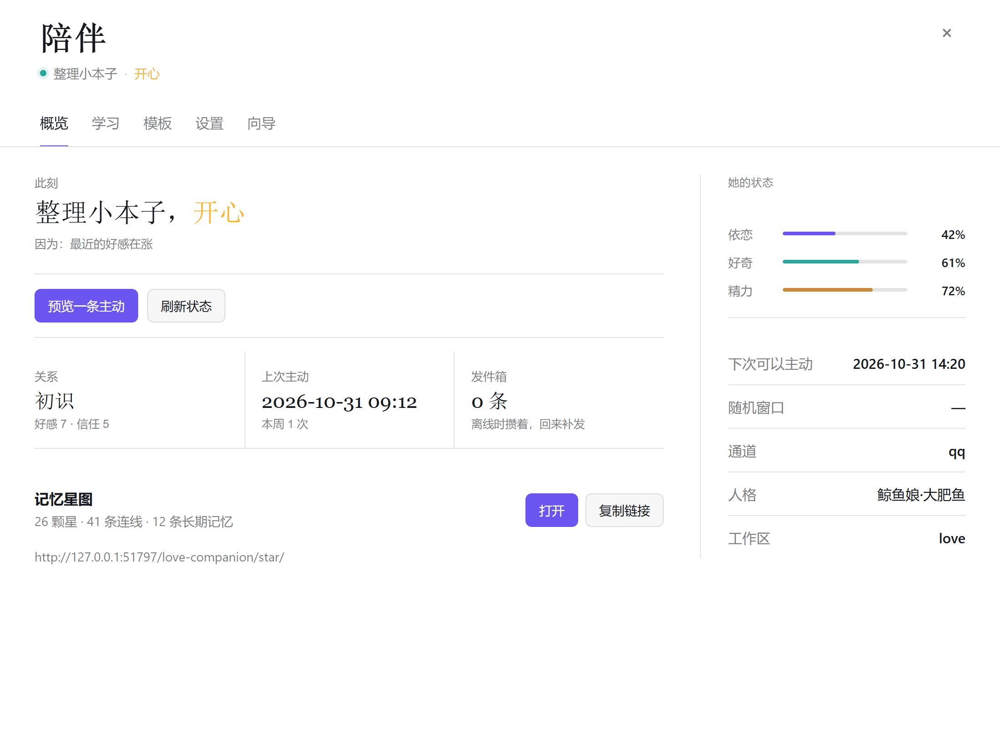
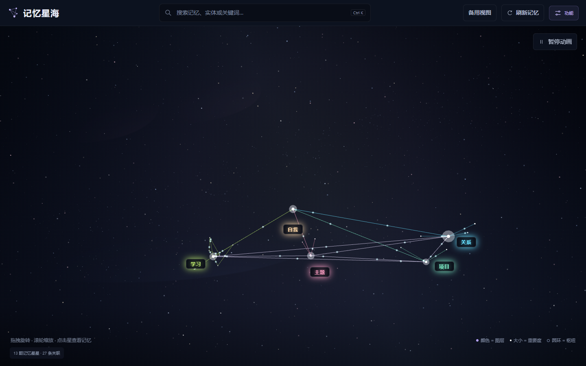

# dsh-memory-network

> **🧪 测试阶段（`1.15.0`）**
> 记忆、核心归纳、反思队列和星图仍在真实使用验证中。
> 误记、漏记、重复、整理卡住属于当前阶段的正常现象；先备份 `memory/`。

给她一个会过日子的灵魂：心情会变、心跳在走、想你了会主动开口；人格可以换、记忆不会丢。

- **活着的循环**：心跳推进「在做什么 / 依恋 / 好奇 / 精力」，冲动够了就主动说话；没发出去的话进发件箱，回来补发。
- **记忆不是日志**：称呼、偏好、边界、关系、日记、小生活、自我叙事、学会的事，按工作区隔离，换人格不丢。
- **人格可切可装**：面板下拉切换，或填表安装新人格 skill；切完自动 doctor 对照记忆条数。
- **模板直出**：主动消息可以零 token 直发；模板按活动/心情分组，可增删改。
- **记忆星图**：把记忆、日记、小生活、自我画成星座，浏览器里看。
- **纯本地**：文件都在工作区；心跳 0 token，不调模型。





> 大白话手册见 [MANUAL.md](../MANUAL.md)。  
> 来源与分工见 [CREDITS.md](../CREDITS.md)。

## 硬性范围

每个工具和调度器都先检查 `agent.session.header.cwd`：

- 只有配置的 `workspace`（默认 `~/love`）会生效
- 其他工作区调用会直接报错：`love-companion：只允许在配置的聊天工作区使用`
- 主动聊天只读记忆，投递走通道：QQ 直发 / 同工作区会话 / 发件箱

## 工具

| 工具 | 作用 |
|---|---|
| `love_recall` | 称呼/偏好/边界/心情/最近日记/记忆网事件 + 自我摘要 + 今天做过什么 |
| `love_mood` | `get` / `refresh`，只读；心情自动生成 |
| `love_life` | 记录/查看没聊天时的小生活 |
| `love_record` | `note` / `fact` / `feeling` / `milestone` |
| `love_core_memory` | 模型自主定义核心、归属和关联；重复确认补来源、明确修正保留取代历史；支持旧记忆迁移与撤回，见 [核心记忆说明](docs/CORE-MEMORY.md) |
| `love_reflection` | 领取真实会话材料并按来源提炼，支持跳过、失败重试和恢复；另有可暂停、带预算的独立后台提炼，见 [会话整理说明](docs/REFLECTION.md) |
| `love_self` | 读/写自我叙事 `memory/self.md`（`get` / `write`） |
| `love_sticker` | 小表情包图库：`list` / `search` / `add`（别人发的表情包会自动收下） |
| `love_learn` | 学习记录：`add`（name/note/source）/ `list` / `search` |
| `love_template` | 模板直出：`list` / `add` / `update` / `remove`（按 activity/emotion） |
| `love_distill` | 把材料蒸馏成人格 skill：身份/口吻/在意/边界/口头禅 → 装机并登记 persona.py |
| `love_proactive` | 主动聊天状态 / dry-run 提示 |
| `love_emoji` | QQ 表情手册：`decode` / `search` / `status` |
| `love_doctor` | 一条命令体检：记忆文件、通道、表情补丁、心跳、发件箱、调度、开关 |

## QQ 表情识别（手册补丁）

### 为什么需要

`dsh-onebot-qq` 默认把 QQ 小黄脸**按顺序**映射成 Unicode emoji，id 在入站那一刻就丢了：

| QQ 表情 | 真实含义 | 默认渲染 | 结果 |
|---|---|---|---|
| `face id=14` 微笑 | 礼貌、疏远、无语 | 🥰 | 模型当成「心里冒粉红泡泡」 |
| `face id=318` 崇拜 | 星星眼、崇拜 | 🦓 | 模型当成斑马 |
| `face id=319` 比心 | 双手比心、喜欢 | 🦌 | 模型当成小鹿 |

### 怎么修

1. **通道补丁**（`patches/patch-onebot-face-ids.mjs`）  
   把 face 段渲染成 `[QQ表情:14]`，id 留下来；mface 顺带渲染成 `[QQ表情包:名字]`。

   ```powershell
   # 改 profile 里的那份副本；升级 dsh-onebot-qq / pnpm install 后要重跑
   node patches/patch-onebot-face-ids.mjs
   node patches/patch-onebot-face-ids.mjs --check
   # 全链路自检（手册 / 补丁 / 注解 / 工具）
   node patches/verify-emoji.mjs
   ```

2. **插件自动注解**  
   插件挂在 `agent/pre-step` 接缝上（和 `agent-instructions` 同一个），只对 love 工作区的入站消息生效，
   把标记就地换成名称 + 真实含义：

   ```
   [QQ表情:14]  →  [QQ表情:14 微笑｜礼貌、疏远或无语的笑，不是开心]
   ```

   模型看到的是人话，不需要自己猜，也不用多调一次工具。

3. **手册数据**（`emoji/`）  
   - `qq-faces.json`：329 条 QQ 表情（id → 名称 → 含义 → 所属表情包），其中 260 条带「含义」
   - `QQ表情手册.md`：同一份数据的人类可读表格

   含义写的是 QQ 语境里的实际用法，不是字面意思（微笑=礼貌/疏远、狗头=开玩笑、呵呵哒=敷衍）。

### 手动查

```
love_emoji action=decode text="[QQ表情:14]"
love_emoji action=decode id=318
love_emoji action=search query=微笑
love_emoji action=status        # 手册条数 + 通道补丁是否已应用
```

越界规则同其它工具：只在 love 工作区可用。

### 配置

```yaml
- id: dsh-memory-network
  config:
    emojiEnabled: true   # false 关掉自动注解（工具仍可用）
```

### 已知限制

- QQ 9.x 的新版黄脸（id 450–484）也有收录；没收录的 id 会注解成「未收录，按上下文理解」，不会吞掉原文。
- 注解写在消息正文里，会跟着会话历史一起存盘；不要把注解原样复述给用户。
- **消息是 deepFreeze 的**：`agent/pre-step` 拿到的是不可变消息，注解只能换新对象（保留 id/role/source），
  不能就地改 `part.text`，否则会抛 `Cannot assign to read only property 'text'` 并把整轮打成错误。
  注解逻辑整体包了 try/catch：出错只记一条 warn，对话照常进行。
- `pnpm install` / 升级 `dsh-onebot-qq` 会覆盖通道补丁；`love_emoji action=status` 可以确认是否还在。


## 灵魂与介质（v1）

灵魂（记忆 / 心情 / 主动）不认识 QQ。它只产出「意图」，由通道适配器投递；通道不在线，意图进发件箱，回来再补发。完整契约见 [SOUL.md](./SOUL.md)。

| 件 | 位置 | 作用 |
|---|---|---|
| 通道适配器 | `channels/qq.js`、`channels/web.js` | QQ：NapCat 探活 + 写 OneBot 注入队列；Web：找同工作区开着的会话，`agent.followup` 投递。未来的 airi 也是同一接口 |
| 发件箱 | `outbox.js` → `memory/outbox.jsonl` | 离线时攒着，6 小时过期；只补最新一条；静默时段不发；聊过了就丢掉 |
| 心跳 | `pulse.js` → `memory/pulse.json` | 每分钟一次、0 token：她在做什么（看书/发呆/整理小本子…）+ 依恋/好奇/精力，参与主动决策 |
| 自动 appraisal | `appraisal.js` | 模型忘了调 `feeling` 的兜底：强信号 ±1，剥掉表情注解再判断，15 分钟冷却 + 每日上限 |
| 直发人话 | `compose.js` | 用模板把意图写成一句可直接发送的话；配了 `qqHttpUrl` 就直发，省掉一整轮模型调用 |
| 灵魂计时器 | `memory/state.json` | `last_seen` / `message_count` 由入站消息更新，不再读 QQ 会话文件 |
| 调度状态 | `memory/proactive.json` | 每个工作区一份；老的 NapCat 状态会在首次读取时自动迁移过来 |

配置里 `channel: qq | web | none`，`qqPort` / `botQQ` / `ownerQQ` 都可以覆盖，不再写死在代码里。
切到 `web` 不用重启：改 `C:\NapCat\love-companion.json` 里的 `channel` 即可（前提是那个工作区的 Web 会话开着）。
想让主动消息零 token 直发：配 `qqHttpUrl` / `qqHttpToken`（NapCat HTTP 接口），详见 CONFIG.md。
自检：`node patches/verify-all.mjs`（49 项，含包完整性）。

## 管理面板

DSH 左侧栏「陪伴」图标 / 侧栏底部按钮打开。布局按重要性排：状态和常用动作在最前，配置往后放。

- **概览**：此刻在做什么 + 心情、关系 / 上次主动 / 发件箱三栏、依恋/好奇/精力三条状态条、常用动作（预览一条主动、刷新状态）、记忆星图入口（在浏览器打开 / 复制链接）、下次可发 / 通道 / 工作区。
- **面板适配**：默认按实际可用宽度自动放大，窄面板重排内容。A−/A+ 切到手动并保留倍率；点「自动」恢复随面板宽度调整。概览可使用完整宽度。
- **学习**：她学会的事（能力名/说明/日期/次数），可搜索、可手动补一条。
- **模板**：模板直出的语句，按「活动 / 心情」分组，可展开、增、删、改；删空回到默认。
- **设置**：聊天工作区 + 额外工作区列表（一行一个，每个区一套记忆/心跳）、主动聊天开关/间隔/时段、功能开关、**恢复出厂设置**。
- **向导**：安装与配置清单（工作区 / 通道 / meow / NapCat / 直发接口），缺什么、怎么补；可保存连接参数并重新检测。

首次打开（还没有 `memory/profile.json`）会自动落在「向导」。

恢复出厂设置：需要输入「重置」两个字确认；先把 `memory/` 整份备份到工作区 `.reset-backups/<时间>/`，
再清空称呼/偏好/边界、关系与好感、心情、日记、小生活、自我叙事、表情包图库、发件箱和调度状态。
meow 的长期记忆属于另一个插件，不在这里清。

功能开关：QQ 表情注解 / 心情注入 / 自动好感 / 自动学习 / 模板直发，点一下立刻生效（不重启）。
心跳固定 60 秒一次、纯本地 0 token，所以没有开关。

## 人格

人格只决定「怎么说话」，和记忆、工具、能力完全分开：

- 状态在 `<workspace>/persona.txt`，映射在 `<workspace>/tools/persona.py`。
- 面板「设置 → 人格」下拉可直接切；切完自动跑一遍 `love_doctor` 并显示结果，确认记忆/学习条数没变。
- **安装人格 skill**：同页「安装人格 skill…」填 key / 显示名 / 描述 / 正文，插件会
  写 `.dsh/skills/<skill>/SKILL.md`（自带兼容约定）并登记进 `persona.py`，装完在下拉里选中即可。
- 手动安装：复制 `skills/persona-template/SKILL.md` 到工作区 `.dsh/skills/`，改口吻，再在 `persona.py` 的 `PERSONAS` 里登记。
- 模板里带「兼容约定」，明确人格不接管记忆和能力，换人格不会失忆。

## 安全部署 / 回滚

不要直接覆盖正在运行的插件目录。用：

```powershell
node patches\deploy.mjs            # 自检 → 备份 → 拷贝 → 校验
node patches\deploy.mjs --rollback # 回滚到上一次备份
```

部署完重启 DSH。清单写在目标目录的 `deploy-manifest.json`。

## 记忆星图（浏览器里看）

星图随插件打包（`star/`），但页面用系统浏览器打开，不嵌在面板里：

- 地址：`http://<host>/love-companion/star/`（面板「星图」页签里有「在浏览器打开 / 复制链接」）
- 数据：`GET /love-companion/api/graph`，每次现读现生成，不落 `graph.json`
- 版本：`GET /love-companion/api/graph/status`（页面每 30 秒比对，变了才提示刷新）
- 刷新：`GET /love-companion/api/graph/export`（页面「刷新记忆」调它）

图层：meow 七层 + 记忆网实体/事件 + **陪伴日记（journal）** + **小生活（life）** + **自我叙事（soul）**。
只读；DB 用只读方式打开，读不到就少一层，不影响页面。

面板通过本机 API 读写：

| 方法 | 路径 | 作用 |
|---|---|---|
| GET | `/love-companion/api/status` | 状态、心情、配置、主动窗口 |
| POST | `/love-companion/api/config` | 保存主动参数、工作区路径（运行时） |
| POST | `/love-companion/api/mood` | 只读重算/查看当前心情 |
| POST | `/love-companion/api/dry-run` | 生成一条预览 |
| POST | `/love-companion/api/reset` | 恢复出厂设置；body 必须带 `{"confirm":"RESET"}`，先备份再清空 |
| GET | `/love-companion/api/setup` | 安装清单：工作区 / 通道 / meow / NapCat / 直发接口 |
| GET/POST | `/love-companion/api/templates` | 模板快照 / 增删改（`op=add/update/remove`） |
| GET | `/love-companion/api/state` | 给身体（AIRI）的状态快照：情绪/动作/在场/需求 |

运行时覆盖写入 `C:\NapCat\love-companion.json`，不改 `cordis.patch.yml`；插件重载后仍保留。

## 工作区

面板里的「固定工作区路径」会写入运行时配置。插件每次工具调用都重新读取：

- 记忆 / 心情 / 生活记录路径跟着变
- 只接受已存在的目录
- 主动聊天仍以插件配置的工作区为准

## 与 meow-memory 的关系

- 两个插件**不做代码对接**，各自独立工作
- love-companion 用自己的 JSON 陪伴记忆
- meow 用 SQLite 七层长期记忆
- 分享时把两边都指向同一个工作区即可；agent 分别调用两边的工具
- 不要复制个人 SQLite 或 memory.json

## 配置

插件包自带 `cordis.patch.yml`，作为 bundle 时自动 insert；在 desktop profile 的 `cordis.patch.yml` 里用 `- id` 覆盖配置：

```yaml
- id: dsh-memory-network
  config:
    enabled: true
    workspace: 'C:\test\love'
    proactiveEnabled: true
    minGapHours: 4
    maxGapHours: 12
    dailySkipChance: 0.45
    maxPerDay: 1
    maxPerWeek: 3
    quietAfterChatMinutes: 120
    activeStartHour: 10
    activeEndHour: 22
    voiceChance: 0.08
    voiceCooldownHours: 8
    injectPath: '<USER_HOME>\.dsh\media\onebot\qq-inject.jsonl'
```

- `proactiveEnabled: false` 只保留工具，不自动发消息
- `voiceChance`：`love_recall` / 主动提示里出现「语音提示」的概率，0–1
- `voiceCooldownHours`：两次语音提示之间的最短间隔
- 语音提示只在活跃时段生成；插件不直接调 MCP，由 agent 按提示发
- 时间完全随机：每天在 10:00–22:00 里抽一个时刻，检查间隔 3–11 分钟随机
- 45% 概率当天直接跳过；发送间隔 4–12 小时随机；不是每天必发
- 话题从记忆 / 心情 / 生活里随机挑一类，不按固定权重
- 最多 1 天 1 次、1 周 3 次
- 调度器只在 DSH 运行时工作；DSH 关闭时不会主动发

## 安装

```powershell
powershell -ExecutionPolicy Bypass -File ..\install.ps1
```

然后把 `cordis.patch.yml` 的 `- id: dsh-memory-network` 配置段合并进 desktop profile 的 `cordis.patch.yml`，重启 DSH。

## 与 Python 脚本的关系

`love\...\memory.py` / `net.py` 保留为后备和手工工具；插件直接读写同一份 JSON，不依赖 Python 进程。

## 一键修复 / `/love-setup`

- 面板「向导 → 一键修复配置」：备份并重写运行时配置 + NapCat 的 OneBot 反向 WS（可选 HTTP 直发），不装依赖。
- 会话里输入 `/love-setup`：同样的事，返回一份修复报告。
- 完整安装（登记 profile、装依赖、配 NapCat）用仓库根目录的 `install.ps1`。

## 发布包

```powershell
powershell -ExecutionPolicy Bypass -File .\build-release.ps1
# 生成 dist/love-suite-<版本>.zip，解压后直接跑 install.ps1
```
